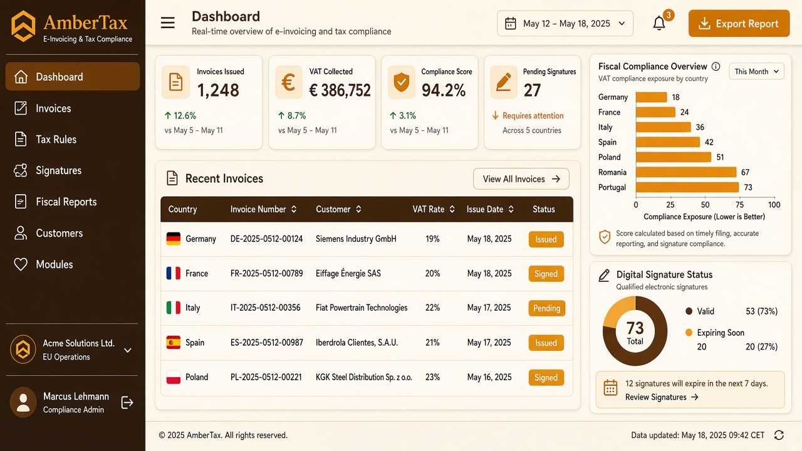

# Vertical E-Invoicing Tool (Tax Compliance)



**Vertical e-invoicing and tax compliance platform for multi-country invoices, VAT/GST rules, digital signatures, and audit-ready fiscal reporting.**

[](https://laravel.com)
[](https://filamentphp.com)
[](https://www.php.net)
[](./docker-compose.yml)
[](https://imrandev.bd)

> SEO keywords: vertical e-invoicing, tax compliance platform, multi-country invoices, VAT GST rules engine, digital invoice signature, audit-ready fiscal reporting, PEPPOL clearance, customer invoice portal, Laravel Filament finance SaaS, modular tax modules on off.

---

## Why Vertical E-Invoicing?

Generic billing tools stop at PDF totals. **Vertical E-Invoicing** is a complete fiscal operating system: jurisdiction catalogs, VAT/GST rule resolution, clearance-ready invoice states, digital signatures, fiscal period packs, customer portal access, and a module switchboard so each business only runs what their auditors require.

Built for finance and compliance leaders who need to answer:

- Which VAT/GST rate applies in this country and category?
- Has this invoice been digitally signed and cleared?
- Can we produce an audit-ready fiscal report for the period?
- Which modules should we disable until our PEPPOL / ZATCA mandate starts?

Accent theme: **`#B45309`** (amber / brown) — production Filament admin + public marketing site.

---

## Product Snapshot

| Capability | What you get |
|---|---|
| Modular runtime | Enable/disable 12 fiscal modules (core modules protected) |
| Multi-role IAM | Super Admin, Admin, Manager, Staff, Client, Demo |
| Multi-country invoices | BD, AE, IN, GB, SA, SG jurisdictions with formats |
| Tax engine | VAT/GST/sales tax/reverse charge/zero-rated rules |
| Digital signatures | RSA-SHA256 demo signatures bound to invoice totals |
| Fiscal reports | Period packs with taxable base & tax payable |
| Customer portal | Token-ready self-serve invoice visibility |
| Audit trail | Event ledger for invoice lifecycle actions |
| ROI analytics | Hours, invoices processed, cost saved, ROI % |
| Public pages | Home, Features, Modules, Invoices, Tax Rules, Pricing, Portal, Demo |
| Filament admin | Full CRUD resources + amber dashboard stats |
| Packagist stack | drutogoti, admin-panel, ai-hub, ai-catalog, attendance-hub, unicode-pdf, universal-slug |

---

## Live Demo Credentials

After `php artisan migrate --seed`:

| Role | Email | Password |
|---|---|---|
| **Demo** | `demo@einvoice.test` | `password` |
| Super Admin | `admin@einvoice.test` | `password` |
| Admin | `tax-admin@einvoice.test` | `password` |
| Manager | `manager@einvoice.test` | `password` |
| Staff | `staff@einvoice.test` | `password` |
| Client | `client@einvoice.test` | `password` |

Admin panel: `/admin` · Marketing: `/` `/features` `/modules` `/invoices` `/tax-rules` `/pricing` `/portal` `/demo`

---

## Business ROI & Time-Saver Opportunities

### Executive outcomes
- **Cut manual tax lookup** with jurisdiction + rule catalog resolution via `TaxEngine`.
- **Reduce clearance rework** by validating, signing, and tracking invoice status transitions.
- **Ship fiscal packs faster** with period reports that roll up taxable base and tax payable.
- **Prove compliance capacity** with Compliance Metrics (hours, invoices, cost saved) and ROI %.
- **Right-size footprint** by disabling PEPPOL, attendance, or AI assist until needed.

### Department time-savers
| Department | Opportunity | Typical weekly hours unlocked (seed model) |
|---|---|---|
| Billing | Multi-country invoice issuance | ~30h |
| Tax | VAT/GST rule application | ~26h |
| Compliance | Digital signatures + audit trail | ~24h |
| Finance | Fiscal reporting packs | ~18h |
| AP/AR | Customer portal self-serve | ~12h |
| Ops | Unicode PDF / AI assist / catalog | ~24h |

**Compounding effect:** enabled modules estimate **100+ hours/week** of fiscal automation capacity in the demo seed — the dashboard records actuals from compliance metrics.

### Opportunity backlog for implementers
1. Push clearance submissions through PEPPOL / ZATCA / GSTN adapters when `peppol_bridge` is enabled.
2. Route invoice line suggestions through `imrandevbd/laravel-ai-hub` via AI Invoice Assist.
3. Render multilingual fiscal PDFs with `laravel-unicode-pdf`.
4. Sync field workforce clocks via `laravel-attendance-hub` for hybrid service invoicing.
5. Enrich tax authority catalogs with `laravel-ai-catalog` scrapers.
6. Accelerate page delivery with `drutogoti` performance helpers.
7. Extend Filament surfaces using `laravel-admin-panel` patterns.
8. Keep SEO-safe multilingual slugs with `laravel-universal-slug`.

---

## Modules (On / Off)

Every module is a first-class record (`modules` table) with `is_enabled`, `is_core`, category, and estimated weekly hours.

| Key | Name | Category | Core |
|---|---|---|---|
| `multi_country_invoicing` | Multi-Country Invoicing | invoicing | Yes |
| `vat_gst_engine` | VAT / GST Tax Engine | tax | Yes |
| `digital_signatures` | Digital Signatures | compliance | No |
| `fiscal_reporting` | Fiscal Reporting | reporting | Yes |
| `customer_portal` | Customer Portal | portal | No |
| `audit_trail` | Audit Trail | compliance | No |
| `peppol_bridge` | PEPPOL / Clearance Bridge | interoperability | No |
| `tax_rule_catalog` | Tax Rule Catalog | tax | No |
| `unicode_pdf_invoices` | Unicode PDF Invoices | reporting | No |
| `ai_invoice_assist` | AI Invoice Assist | ai | No |
| `attendance_bridge` | Attendance Machine Bridge | workforce | No |
| `roi_analytics` | ROI & Compliance Analytics | analytics | Yes |

`ModuleRegistry` caches lookups, blocks disabling core modules, and feeds marketing + dashboard KPIs.

---

## Domain Model

- **Users** — roles via `UserRole` enum; Filament access gated by role.
- **Module** — feature flags for the fiscal stack.
- **TaxJurisdiction** — country authority, currency, clearance/signature requirements.
- **TaxRule** — scheme + rate catalog with effective dates.
- **Customer** — buyer parties with portal tokens.
- **Invoice** + **InvoiceLine** — multi-country tax-aware documents.
- **DigitalSignature** — certificate subject + hash ledger.
- **FiscalReport** — period fiscal packs.
- **AuditEvent** — lifecycle evidence.
- **ComplianceMetric** — ROI facts.

Services: `ModuleRegistry`, `TaxEngine`, `InvoiceService`, `SignatureService`, `FiscalReportService`, `RoiCalculator`.  
Policies: `ModulePolicy`, `InvoicePolicy`.

---

## Filament Admin Resources

- Modules · Tax Jurisdictions · Tax Rules · Customers · Invoices · Digital Signatures · Fiscal Reports · Audit Events · Users  
- Dashboard widget: **EinvoicingStatsOverview** (invoices, tax collected, signatures, jurisdictions, fiscal reports, modules, ROI)

Brand color: `#B45309`.

---

## Public Marketing Pages

| Route | Purpose |
|---|---|
| `/` | Hero + KPI + modules + live invoices |
| `/features` | Full feature catalog by category |
| `/modules` | Module on/off matrix |
| `/invoices` | Multi-country invoice showcase |
| `/tax-rules` | Jurisdiction + rate catalog |
| `/pricing` | Pricing tiers + live ROI snapshot |
| `/portal` | Customer portal demo |
| `/demo` | Demo credentials CTA |

---

## Tech Stack & Packages

- PHP 8.3+ · Laravel 13 · Filament 5 · Livewire · SQLite/MySQL  
- Packagist (`dev-main` / aliased for Laravel 13 compatibility where upstream constraints lag):
  - `imrandevbd/drutogoti`
  - `imrandevbd/laravel-admin-panel`
  - `imrandevbd/laravel-ai-catalog`
  - `imrandevbd/laravel-ai-hub`
  - `imrandevbd/laravel-attendance-hub`
  - `imrandevbd/laravel-unicode-pdf`
  - `imrandevbd/laravel-universal-slug`

> Note: some upstream packages declare Laravel 11/12 only; this repo includes Composer repository overrides so they install cleanly on Laravel 13 for portfolio/demo use. Prefer upstream version bumps for long-term production.

---

## Quick Start

```bash
composer install
copy .env.example .env   # Windows
php artisan key:generate
touch database/database.sqlite
php artisan migrate --seed
php artisan serve
```

Visit `http://127.0.0.1:8000` and `http://127.0.0.1:8000/admin`.

### Docker

```bash
docker compose up --build
```

App: `http://localhost:8080` · MySQL published on `3307`.

---

## Testing

```bash
php artisan test
```

Feature coverage includes marketing routes and module toggle rules.

---

## Architecture Principles

1. **Modules first** — fiscal capabilities are data, not hard-coded ifs scattered everywhere.
2. **Roles with intent** — Demo can explore; Clients stay out of admin; Super Admin owns destructive ops.
3. **Measure or it didn’t happen** — compliance metrics convert hours into executive ROI.
4. **Jurisdiction-aware** — invoices always carry country, scheme, and rate context.
5. **Production posture** — Docker, `.env.example`, seeders, policies, services, Filament resources, public SEO pages.

---

## Author

**Imran Ahmed** · [imrandev.bd](https://imrandev.bd) · [me@imrandev.bd](mailto:me@imrandev.bd) · GitHub [@imranbru99](https://github.com/imranbru99)

---

## 🤝 Let's Connect & Collaborate

I am open to Senior Remote Full-Stack Roles, AI Platform Architecture Contracts, and Enterprise Technical Advisory.

Timezone: UTC+6 (Dhaka / Rangpur, Bangladesh) — Flexible overlap with US, UK, and European business hours.

Delivery Mode: Async-ready, Slack, Discord, Jira, GitHub, and production-first accountability.

| Channel | Address / Handle | Quick Action |
|---|---|---|
| 🌐 Primary Portfolio | [imrandev.bd](https://imrandev.bd) | [Visit Site ↗](https://imrandev.bd) |
| 📦 Packagist Packages | [packagist.org/packages/imrandevbd/](https://packagist.org/packages/imrandevbd/) | [View Packages ↗](https://packagist.org/packages/imrandevbd/) |
| 💼 LinkedIn Profile | [linkedin.com/in/imranbru99](https://linkedin.com/in/imranbru99) | [Connect ↗](https://linkedin.com/in/imranbru99) |
| 🐙 GitHub Profile | [github.com/imranbru99](https://github.com/imranbru99) | [Follow ↗](https://github.com/imranbru99) |
| 💬 WhatsApp Direct | +880 1576-918420 | [Chat Now ↗](https://wa.me/8801576918420) |
| 📧 Direct Email | me@imrandev.bd | [Send Email ↗](mailto:me@imrandev.bd) |
| 🐦 X (Twitter) | [@imrandev_bd](https://x.com/imrandev_bd) | [Follow ↗](https://x.com/imrandev_bd) |
| 📺 YouTube Tech | [@ImranDevBD](https://youtube.com/@ImranDevBD) | [Subscribe ↗](https://youtube.com/@ImranDevBD) |
